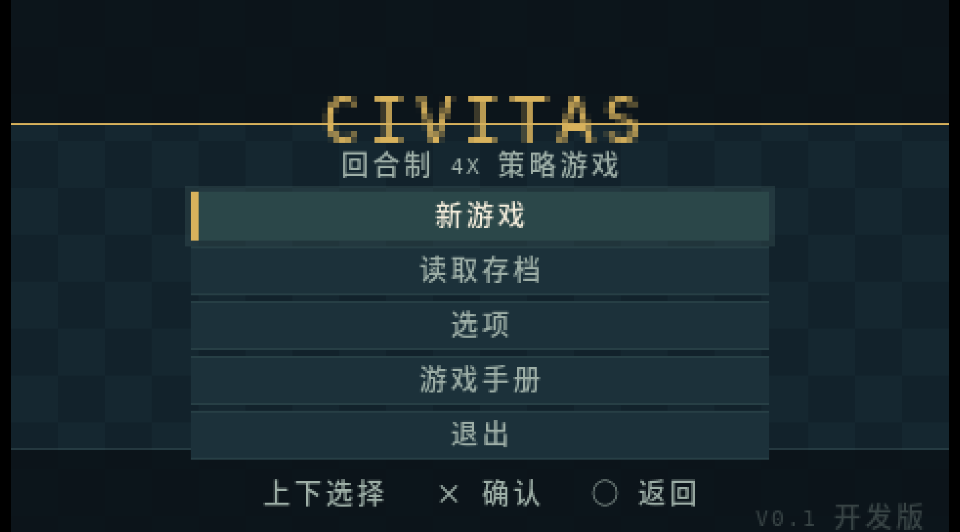

# CIVITAS PSP

**V0.1 Developer Release** · A turn-based 4X strategy game for the PSP 1000.

[中文](README.md) | [English](README.en.md)

CIVITAS is built with PSPSDK and the PSP GU 2D API. It runs at 480×272 on a
fixed 64×48 map and is designed for short-session 4X play on the PSP.



## Contents

- [Features](#features)
- [Controls](#controls)
- [Building and running](#building-and-running)
- [Release package](#release-package)
- [Project structure](#project-structure)
- [Documentation](#documentation)
- [Tests](#tests)
- [Known limitations](#known-limitations)

## Features

- **Complete 4X loop**: explore a 64×48 map, found cities, expand borders,
  research 30 technologies, build armies, and win by conquest, science,
  diplomacy, or score.
- **Four civilizations and barbarians**: Aurelia (player), Borea, Cyrene,
  Draven, and hostile barbarians. Units and cities use civilization-colored
  sprite variants with owner bars.
- **City management**: 5×5 work area, citizen assignment and locking, food
  growth/starvation, production queues, gold rush, nine buildings, border
  growth, and tile purchase.
- **Military system**: settlers, warriors, scouts, swordsmen, horsemen, and
  workers; terrain and city defense, counterattacks, healing, and city capture.
- **Diplomacy**: relations, gifts, trade, non-aggression pacts, open borders,
  alliances, AI proposals, and diplomatic victory.
- **Two modes**: Standard (200 turns, score ending) and Timed (30/60/90
  minutes), with three manual save slots plus autosave.
- **Chinese and English UI**: Chinese is the default; English can be selected
  in Options. The 12-page in-game manual is available from the main menu and
  Pause.
- **Explored-range minimap**: bottom-right panel, collapsed by default and
  toggled with `L + R`; shows explored terrain, visible terrain, cities, units,
  cursor, and camera view.
- **Generated audio**: an 8-second ambient loop and eight sound effects, with a
  music toggle in Options.
- **PSP presentation**: custom XMB icon/background, menu fade/slide
  transitions, selection glow, and civilization color variants.

## Controls

| Input | Action |
|---|---|
| D-Pad | Move map cursor |
| Analog stick | Pan camera |
| Cross | Select / confirm / act |
| Circle | Back / pause |
| Triangle | Unit action menu |
| Square | Tile information |
| L / R | Cycle units |
| L + R | Toggle minimap |
| Start | Diplomacy |
| Select | End turn |

City screen: `L/R` switches tabs, `Cross` queues production or selects a
citizen action, `Triangle` buys/locks, `Square` auto-assigns citizens.

## Building and running

### Requirements

- [pspdev](https://github.com/pspdev/pspdev) toolchain on `PATH`
- GNU Make
- Python 3 with Pillow for regenerating assets
- Noto Sans CJK / DejaVu fonts if regenerating the Chinese font and XMB art

### Build

```bash
export PATH=$PATH:/home/zhang/pspdev/bin
make clean
make -j4
```

This produces `EBOOT.PBP` and `civpsp.elf` in the project root.

To regenerate strings, fonts, audio, XMB art, and the terrain atlas:

```bash
make assets
```

### Test

```bash
make test
```

The current gate runs **13 host suites** plus Chinese/English and generated
audio checks.

### Run in PPSSPP

```bash
PPSSPP --windowed --graphics=software civpsp.elf
```

You can also open `EBOOT.PBP` directly in PPSSPP. For a PSP, copy the EBOOT to:

```text
ms0:/PSP/GAME/CIVPSP/EBOOT.PBP
```

`ICON0.PNG` and `PIC1.PNG` are embedded in the EBOOT by the build.

## Release package

The V0.1 development package is in:

```text
release/v0.1/
├── EBOOT.PBP
├── civpsp-v0.1.zip
└── SHA256SUMS
```

`civpsp-v0.1.zip` contains the EBOOT ready to copy to the PSP.

## Project structure

```text
.
├── src/                 PSP game code and generated assets
│   ├── app.c            state machine, menus, save/load, transitions
│   ├── map.c            map generation, fog, connectivity
│   ├── mapview.c        map rendering, cursor, minimap, actions
│   ├── city.c           city yields, growth, production, borders
│   ├── cityview.c       city screen
│   ├── tech.c           30-tech tree and effects
│   ├── world.c          civilizations, turns, economy, scoring
│   ├── combat.c         damage, defense, capture
│   ├── diplomacy.c      relations, treaties, trade
│   ├── save.c           version-2 save format
│   ├── audio.c          audio thread and mixer
│   ├── text.c           English/Chinese text rendering
│   └── gen/             generated strings, fonts, audio PCM, atlas
├── assets/
│   ├── strings.csv      English/Chinese UI strings
│   └── src/             source PNG/WAV assets
├── tools/               Python asset/string/audio generators
├── tests/               host logic tests
├── docs/                status, handoff, decisions, data sheet, screenshots
├── release/             local release packages (binaries ignored by Git)
├── Makefile
├── ICON0.PNG / PIC1.PNG
├── UPDATE.md
├── UPDATE.en.md
├── PROJECT_PLAN.md
└── README.md / README.en.md
```

## Documentation

- [UPDATE.en.md](UPDATE.en.md) — V0.1 release notes and changelog
- [UPDATE.md](UPDATE.md) — Chinese release notes
- [docs/GAME_DATA.md](docs/GAME_DATA.md) — complete unit/building/tech/economy data
- [docs/HANDOFF.md](docs/HANDOFF.md) — development handoff and hardware checklist
- [docs/STATUS.md](docs/STATUS.md) — detailed milestone and validation history
- [docs/DECISIONS.md](docs/DECISIONS.md) — design decisions and simplifications
- [PROJECT_PLAN.md](PROJECT_PLAN.md) — original scope and milestone plan
- [docs/README_MILESTONES.md](docs/README_MILESTONES.md) — archived milestone README

## Tests

- 13 host test suites: map, units, city, tech, improvements, combat, AI,
  diplomacy, analog, save, M7 scoring, M8 tech/science, M9 i18n
- `tools/check_i18n.py`: translation coverage, placeholders, glyphs, width
- `tools/check_audio.py`: WAV format and non-silent peaks

PPSSPP has exercised the main menu, manual, map, city tabs, diplomacy, saves,
minimap, score result, and both languages. The latest V0.1 audio and package
should still be rechecked on a PSP 1000.

## Known limitations

- V0.1 is a development snapshot; final PSP 1000 validation of the latest
  package is still in progress. PPSSPP is the primary validated target.
- No naval units; coast/ocean are barriers.
- Trade is gold-only; open borders share vision but do not gate movement.
- Borders expand by influence or purchase; there is no culture/border movement
  gating yet.
- The technology screen is a flat scroll rather than an era-grouped tree.
- Difficulty selection, overlapping sound effects, and a settings-menu minimap
  toggle are future work.
- Save format is version 2; saves from M7/M8/M9 development builds should load.

## Version

**V0.1** is the first GitHub development release, consolidating the M0–M9.12
development line. Internal milestone tags remain in the repository history.
